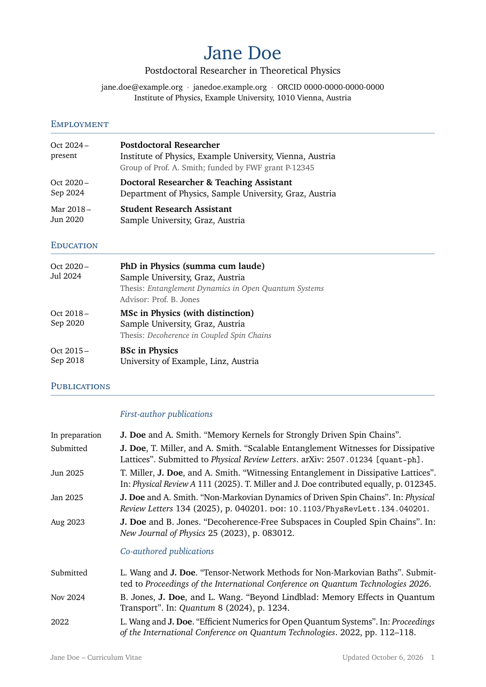

# Academic CV template

[](https://github.com/teutoburg/dyn-ac-cv/actions/workflows/build.yml)

A LaTeX CV for academic job applications where **you only edit data, not layout**.
Entries go into small data files and your `.bib` file. The template sorts,
groups and formats them, and a GitHub Action builds the PDF on every push.



## What it does for you

- Employment, education, teaching and talks are sorted newest-first automatically, so you can add entries anywhere in a file.
- Publications come straight from your `.bib` file. They are split into first-author and co-authored papers automatically, and your name is in bold.
- Papers that are *submitted* or *in preparation* only need a minimal bib entry.
- Teaching is grouped by role (lecturer / student tutor) and then by year. A year with several courses becomes a bullet list.
- Every push to `main` builds the PDF and publishes it under a permanent download link.

## Contents

1. [Getting started](#getting-started)
2. [Where everything goes](#where-everything-goes)
3. [Editing entries](#editing-entries)
4. [Publications](#publications)
5. [Automatic builds on GitHub](#automatic-builds-on-github)
6. [Customising the look](#customising-the-look)
7. [Troubleshooting](#troubleshooting)

## Getting started

### Option A: GitHub (recommended)

1. Click **Use this template → Create a new repository** at the top of this page.
   Consider making your copy **private** (see [privacy](#privacy)).
2. Edit `data/personal.tex` with your name and contact details.
3. Replace `publications.bib` with your own bibliography.
4. Replace the example entries in `data/employment.tex`, `data/education.tex`,
   `data/teaching.tex` and `data/talks.tex`.
5. Commit and push. After a minute or two, the PDF appears under **Releases** on
   your repository page.

You can edit the files directly in the GitHub web interface. You don't need to
install LaTeX for this route.

### Option B: Overleaf

Download this repository as a ZIP (**Code → Download ZIP**). Then, in Overleaf,
choose **New Project → Upload Project** and select the ZIP. Overleaf compiles it
with pdfLaTeX and Biber automatically. If your Overleaf plan includes GitHub
sync, you can link the project to your GitHub copy instead and get both.

### Option C: Locally

You need a TeX distribution with `biblatex` and `biber` (TeX Live or MiKTeX):

```bash
latexmk -pdf main.tex
```

## Where everything goes

| File | What goes in it |
|---|---|
| `data/personal.tex` | Your name, position, contact details. **Start here.** |
| `data/employment.tex` | Positions held |
| `data/education.tex` | Degrees |
| `data/teaching.tex` | Courses, as lecturer and as student tutor |
| `data/talks.tex` | Talks and posters |
| `publications.bib` | All your publications, including submitted and in-preparation |
| `main.tex` | Section order, fonts, page layout, biblatex settings. Edit only to change the structure or look. |
| `academiccv.sty` | The machinery. You shouldn't need to touch it. |
| `.github/workflows/build.yml` | The automatic PDF build |

Each data file starts with a comment block listing every available field.

## Editing entries

Every entry is a command with `key = value` pairs. Fields can be given in any
order, and every field except the date is optional. If you leave a field out,
the layout adjusts:

```latex
\employment{
  from        = 2024-10,
  to          = present,
  position    = Postdoctoral Researcher,
  institution = {Institute of Physics, Example University},
  location    = {Vienna, Austria},
  details     = {Group of Prof.~A.~Smith}
}
```

> **The one rule to remember:** if a value contains a comma, wrap it in braces,
> e.g. `location = {Vienna, Austria}`. Otherwise the comma is read as the start
> of the next field and you get an error like
> *"The key 'academiccv/Austria' is unknown"*.

Values can contain normal LaTeX (`\&`, `~`, `\textit{...}`, accented characters).

### Dates

| You write | Printed as |
|---|---|
| `2023-10` | Oct 2023 |
| `2025-03-14` | 14 Mar 2025 |
| `2023`, `present`, `since 2021`, … | exactly as written |

Entries are sorted by these values, newest first. The `YYYY` or `YYYY-MM` forms
sort correctly. If you write something else, add `sort = 2023-10` to control
where the entry goes.

### Fields per section

| Command | Fields |
|---|---|
| `\personal` | `name`, `bibname`, `position`, `email`, `phone`, `website`, `orcid`, `github`, `address` |
| `\employment` | `from`, `to`, `position`, `institution`, `location`, `details`, `sort` |
| `\education` | `from`, `to`, `degree`, `institution`, `location`, `thesis`, `advisor`, `details`, `sort` |
| `\course` | `role`, `year`, `title`, `term`, `institution`, `details`, `sort` |
| `\talk` | `date`, `title`, `event`, `location`, `type`, `url`, `details`, `sort` |

#### Personal details

- Give `website` as a full URL (`https://…`). It is shown without the `https://`.
- Give `orcid` as just the ID and `github` as just the user name. Both are turned into links.

#### Teaching

- `role` is `lecturer` or `tutor`.
- Courses with the same `year` are grouped together, so write the year the same way for all of them (e.g. always `2023/24`).
- Within a year, courses appear in the order they are written in the file.

#### Talks

- `type` adds a small tag after the title, e.g. `invited`, `contributed`, `poster` or `seminar`.
- `url` makes the title a link, e.g. to the slides.

## Publications

All entries in `publications.bib` are included (`\nocite{*}`).

### First-author vs. co-author

The first author's family name is compared with `bibname` from
`data/personal.tex`. If `bibname` is left out, the last word of `name` is used.
The same name is printed in bold in every author list. Write it exactly as it
appears in your `.bib`, using UTF-8 characters (`Müller`, not `M{\"u}ller`).

You can override the automatic decision per entry with bib keywords:

| `keywords = {...}` | Effect |
|---|---|
| `cv-firstauthor` | Always in the first-author list (e.g. shared first authorship) |
| `cv-coauthor` | Always in the co-author list |
| `cv-exclude` | Not shown in the CV |

### Submitted and in-preparation papers

Add a minimal entry with a `pubstate` field:

```bibtex
@unpublished{doe-inprep,
  author   = {Doe, Jane and Smith, Alice},
  title    = {Memory Kernels for Strongly Driven Spin Chains},
  pubstate = {inpreparation}
}

@article{doe-submitted,
  author     = {Doe, Jane and Miller, Tom},
  title      = {Scalable Entanglement Witnesses},
  journal    = {Physical Review Letters},
  pubstate   = {submitted},
  eprint     = {2507.01234},
  eprinttype = {arxiv}
}
```

- **Allowed values:** `inpreparation`, `submitted`, `accepted`, `inpress`.
- **Left column:** the state is shown instead of a date, and these entries are listed first.
- **Target journal:** if you give one, the entry reads *"Submitted to Physical Review Letters"* rather than *"In: …"*.
- **Conference proceedings:** these work the same way with `@inproceedings` and `booktitle`.
- **Once a paper is published:** fill in the remaining fields and delete the `pubstate` line.

### Dates in the left column

Use `date = {2025-03}`, or `year` plus `month`. If there is no month, only the
year is shown.

### Other list layouts

`main.tex` contains commented-out alternatives. One puts *Submitted and in
preparation* in its own list. Another moves *Conference proceedings* into a
separate section. The available filters are `firstauthor`, `coauthor`,
`firstauthor-published`, `coauthor-published` and `pending`. You can combine any
of them with biblatex's `type=` / `nottype=` options.

## Automatic builds on GitHub

The workflow in `.github/workflows/build.yml` runs on every push to `main`, on
pull requests, and when you start it manually (**Actions → Build CV → Run
workflow**). It does three things:

1. It compiles `main.tex` with [`xu-cheng/latex-action`](https://github.com/xu-cheng/latex-action), which uses a full TeX Live and runs Biber automatically.
2. It uploads the PDF as a workflow artifact, available for 30 days on the run's page under **Actions**.
3. On pushes to `main` only, it replaces the release tagged `latest` with the new `cv.pdf`. The newest PDF is then always at:

   ```
   https://github.com/<your-user>/<your-repo>/releases/latest/download/cv.pdf
   ```

   You can put that link in an email signature or on your website, and it never goes stale.

The "Updated" date in the footer is the date of the build.

To make the badge at the top of this README work in your copy, replace
`OWNER/REPO` with your user and repository name.

### Privacy

In a **public** repository, everyone can see your data files and download the
PDF. If that's not what you want:

- **Make your repository private.** Builds, artifacts and releases are then only visible to you and your collaborators. Private repositories use your account's free Actions minutes; one build takes roughly 1–2 minutes.
- **Or keep it public but skip the release step.** Go to **Settings → Secrets and variables → Actions → Variables** and add a variable `PUBLISH_RELEASE` with the value `false`. The PDF is then still available as a workflow artifact.

### If the release step fails with a permission error

The workflow requests `contents: write` itself. Some organisations restrict
this. In that case, check **Settings → Actions → General → Workflow
permissions** (or ask an organisation admin), or disable the release step as
described above.

## Customising the look

Small tweaks go into the "Optional tweaks" block in `main.tex`:

```latex
\definecolor{cvaccent}{RGB}{120,20,40}           % accent colour
\setlength{\cvdatewidth}{3cm}                    % width of the left column
\cvdeclarerole{tutor}{As a teaching assistant}   % rename a teaching heading
\cvdeclarerole{supervision}{Thesis supervision}  % add a new role
```

**Section order and selection.** The sections are just a sequence of
`\cvsection{...}` + `\print...` lines in `main.tex`. Reorder them, rename them,
or delete the ones you don't need. `\printteaching[tutor]` prints a single role
without its heading.

**Entry layout.** Each entry type is drawn by one macro: `\cvemploymentformat`,
`\cveducationformat`, `\cvcourseformat` or `\cvtalkformat`. To change one, copy
it from section 3 of `academiccv.sty` into the preamble of `main.tex`, change
`\newcommand` to `\renewcommand`, and edit it. Optional fields use
`\ifblank{#n}{<if empty>}{<if given>}`.

**Header.** The name, position line and separator are set by `\cvnamestyle`,
`\cvpositionstyle` and `\cvcontactsep`. You can `\renewcommand` them the same
way.

**Font.** The template uses XCharter. Remove the `\usepackage{XCharter}` line
for Computer Modern, or load another font package.

**Bibliography style.** The biblatex options are at the top of `main.tex`, e.g.
`maxbibnames` for long author lists or `giveninits` for full first names.

## Troubleshooting

| Symptom | Fix |
|---|---|
| *The key 'academiccv/…' is unknown* | A value contains a comma: wrap it in braces. Or there is a typo in a field name. |
| *Unknown teaching role 'x'* | Use `lecturer` or `tutor`, or declare the role with `\cvdeclarerole{x}{Heading}` in `main.tex`. |
| All papers end up under "Co-authored" | `bibname` doesn't match your family name in the `.bib` exactly (check spelling and accents). |
| Publications missing entirely | Biber didn't run. Overleaf and the GitHub Action run it automatically. Locally, use `latexmk -pdf main.tex`. |
| Courses of one year appear twice | The `year` is written differently (e.g. `2023` vs `2023/24`). |
| An entry is sorted in the wrong place | Use `YYYY-MM` dates, or add `sort = YYYY-MM`. |

## License

MIT. See [LICENSE](LICENSE).
